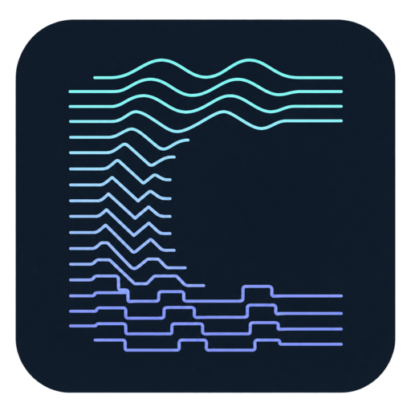
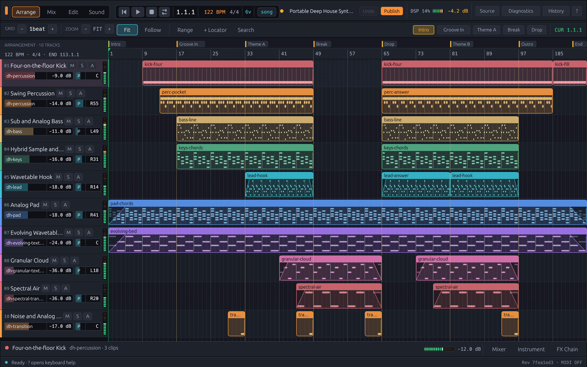
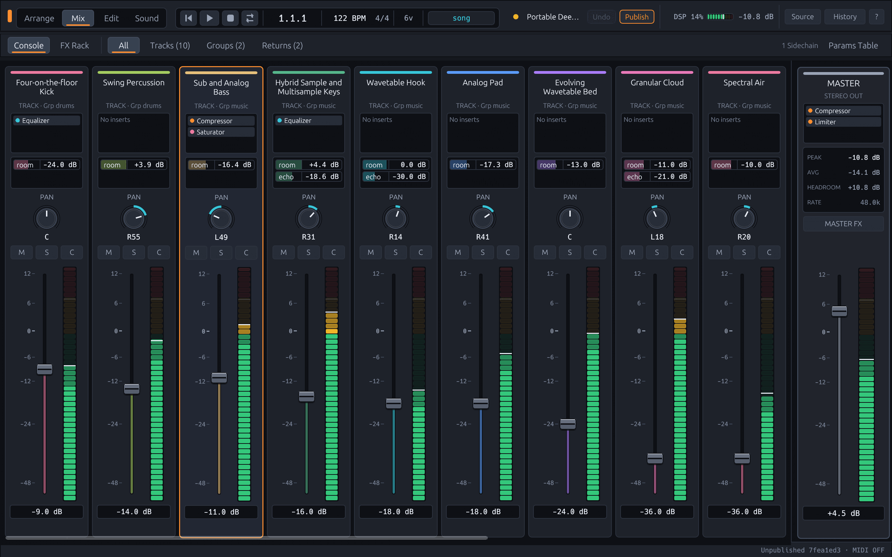
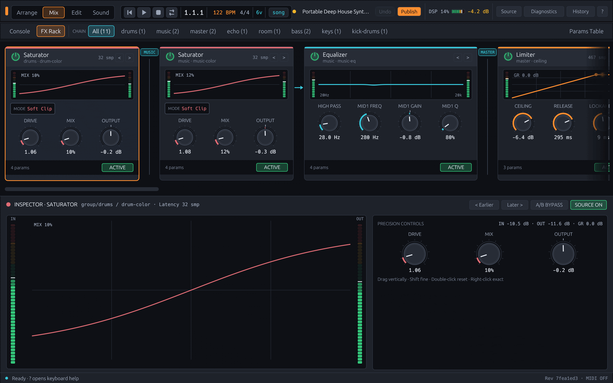
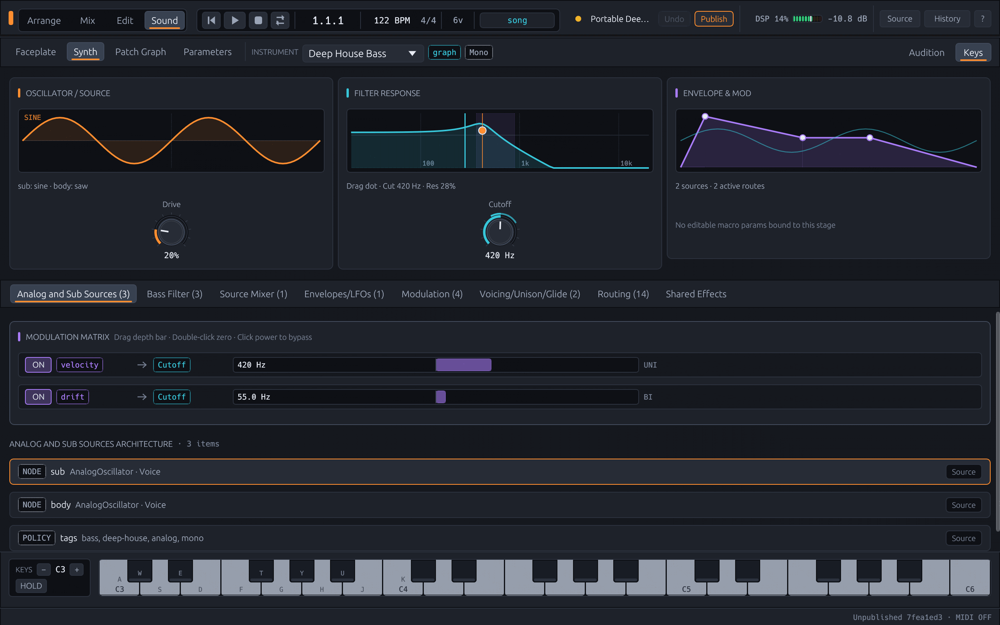
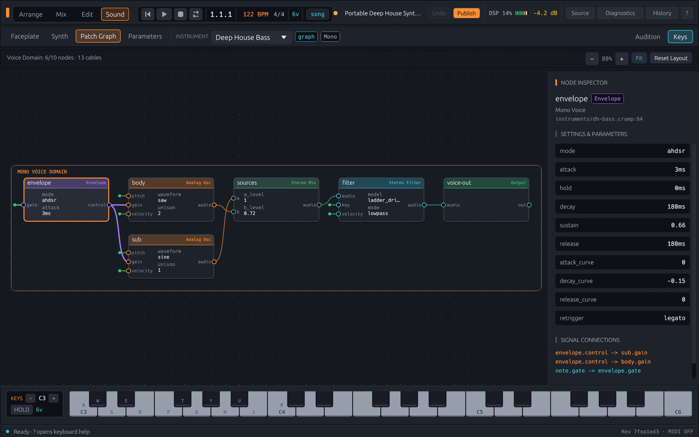
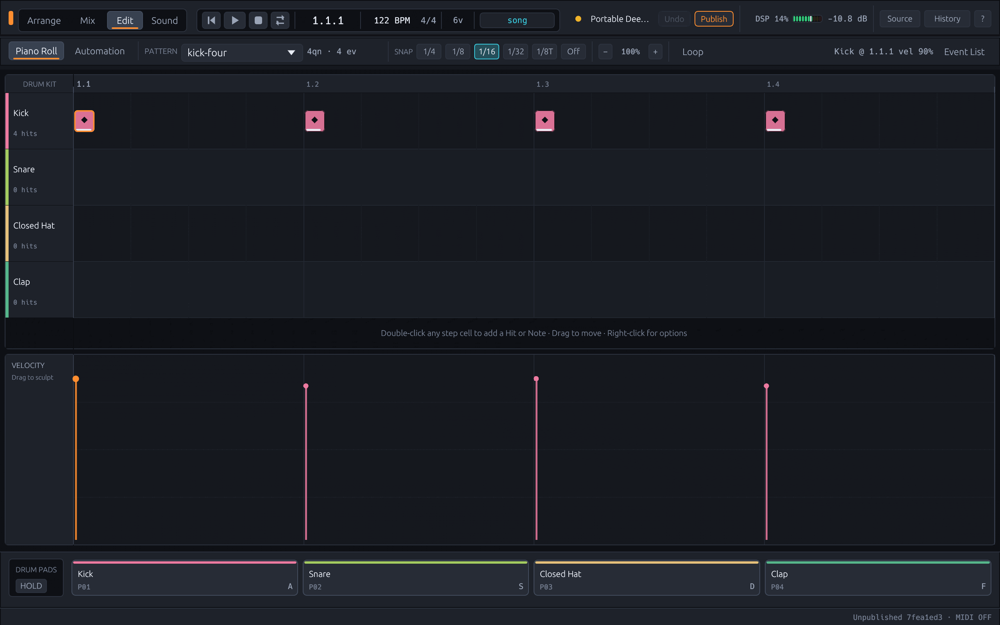

# Crump

Crump is a music production tool for making electronic music. It runs as a desktop window or in your terminal, and both clients are fully keyboard-driven. The song itself is stored as plain text files you can read, diff and commit.



Every sound is built from Crump's own synths, samplers and effects. There are no plug-ins. A project is a folder of `.crump` files plus any WAV samples it uses. You can edit it in the workspace, in your text editor, or through the `crump` CLI, and all three see the same files. That last part makes Crump work well with coding agents. Every command has a `--json` mode that returns one structured response.

Crump runs on Linux and plays audio through PipeWire.

## What's in it

- **Arrangement:** tracks, clips, reusable patterns and pattern variations, locators, and groove templates.
- **Sound:** virtual-analog, wavetable, sample, multisample, granular and spectral sources, all wired together as graphs you write yourself. There are also stock drums and a WAV-based sampler.
- **Movement:** automation, per-step parameter locks, LFOs, and an envelope follower. Playback and offline rendering share the same sample-accurate evaluation, so they sound identical.
- **Mixing:** groups, returns, sends and sidechains, with latency compensation. Built-in effects are EQ, compressor, delay, reverb, saturation, chorus/flanger, bitcrusher, stutter and limiter.
- **Rendering:** deterministic 48 kHz stereo masters and stems, each with a manifest, a hash and audio analysis.
- **History:** every edit and publish is recorded and can be diffed or restored.

Crump does not do audio recording, third-party plug-ins, MPE, or playback on anything other than Linux. [docs/support.md](docs/support.md) lists the full set of limits.

## How a project works

You edit the files on disk, and Crump only plays a version once you've published it.

```text
edit files ──▶ validate ──▶ publish ──▶ play / render
  (candidate)                 (active)
```

If you save a broken edit, playback keeps using the last good version. The error points to the file, line and column:

```console
$ crump validate
crump: validation_failed: Candidate Revision is invalid
instruments/dh-bass.crump:5:3: error[CRV024]: authored Parameter value is outside its legal domain
```

This is what makes it safe to have an editor, an agent and the workspace all open on the same project.



## Install

Crump targets Ubuntu 26.04 (amd64) with PipeWire 1.6 and Rust 1.88 or newer.

```bash
sudo apt install build-essential dpkg-dev pkg-config libpipewire-0.3-dev libclang-dev
git clone https://github.com/NathanaelRea/crump.git
cd crump
cargo install --path . --locked
crump doctor
```

To build without PipeWire, run `cargo build --release --no-default-features --features tui`. That build has no playback, but validation, history, rendering and the workspace still work. Leaving out `tui` as well drops the terminal client and its dependencies, keeping the library, the client-independent workspace session and every non-interactive CLI command. To build a `.deb` package, run `packaging/build-deb.sh dist`.

## Desktop window

Crump opens a desktop window by default. It shows the same views as the terminal workspace and takes the same keys, and adds full mouse editing: drag clips, faders, knobs and automation points, draw notes in the piano roll, and Ctrl-scroll to zoom. Every edit is saved, validated and recorded in History like any other.

| | |
|---|---|
|  |  |
|  |  |

Running `crump` with no command opens it whenever a Wayland or X11 display is available; on a plain terminal (SSH, a console) you get the terminal workspace instead, and `crump gui` / `crump workspace` pick one explicitly. To try it from a checkout:

```sh
cargo run --release -- --project fixtures/deep-house-reference
```

Use `--release`: a debug build is too slow for the realtime audio thread, and the system kills the process when playback starts. Run from a terminal without `--project` and it offers the project picker. To build without the window, use `--no-default-features --features pipewire,tui`. More in [docs/workspace.md](docs/workspace.md#desktop-window).

## Quick start

```bash
crump new my-sketch --name "My Sketch"
cd my-sketch
crump
```

A new project starts out silent. For something to listen to, copy the reference project:

```bash
cp -R fixtures/reference neon-steps
crump --project neon-steps publish --origin human --actor "$USER" \
  --summary "Adopt reference sketch" --explanation "First publish"
crump --project neon-steps play
crump --project neon-steps render --output render/master
crump --project neon-steps render --output render/stems --stem track/lead:post_fader
```

### Workspace keys

| Key | |
| --- | --- |
| `1`–`9`, `0` | Timeline, Mixer, Processing, Event Grid, Faceplate, Instrument, Parameters, Automation, Graph, Source |
| `Tab` / `Shift-Tab` | Next / previous view, including Diagnostics, History and Help |
| `Space` / `S` | Play or pause / stop |
| `j` `k` `h` `l` | Move around. In Timeline, `h`/`l` move by the current grid |
| `V`, then `L` | Select a range in Timeline and loop it |
| `:` | Jump to a bar, beat or locator |
| `i` | Play the current instrument from the computer keyboard (`Esc` to leave) |
| `P` | Publish the current edits |
| `?` | Help |
| `Ctrl-C` | Quit (`q` and `Esc` never quit) |

The full keymap is in [docs/workspace.md](docs/workspace.md).

## Examples

- [`fixtures/reference/`](fixtures/reference/): a short three-track synth sketch.
- [`fixtures/deep-house-reference/`](fixtures/deep-house-reference/): a 112-bar deep-house track that uses every kind of sound source. It's the project in the screenshots above.
- [`fixtures/starter/`](fixtures/starter/): nine starter instruments with audition phrases.
- [`examples/instruments/`](examples/instruments/README.md): 184 instruments you can copy, including house sounds, a 32-piece orchestra, drum machines and world instruments. The [instrument player](tools/instrument_player/README.md) lets you play all of them in a browser.
- [`examples/waveguides/`](examples/waveguides/README.md): a plucked string, a sitar and a clarinet, each built from feedback loops in plain `.crump`.

In each project, every instrument lives in its own `instruments/<id>.crump` file, and `project.crump` imports them. Copy the whole directory to keep the imports working.

## CLI

```text
new  validate  inspect  status  publish  check  workspace  gui  play  render  qualify  doctor
history  list | show | diff | restore
edit     parameters, notes, clips, automation, locators, grooves, samples, ...
asset    import | import-wavetable | collect | bounce | prepare | list
module   export | install | list | inspect | preview | copy | collect
```

Add `--json` to any non-interactive command to get a single JSON response:

```console
$ crump --json status
{"command":"status","data":{"active_entry":"000000000001","candidate_valid":true,"state":"active",...},"ok":true,"schema_version":1}
```

Edits made through `edit` keep your formatting and comments. They also refuse to apply if the file has changed since you last read it.

## Docs

- [Workspace](docs/workspace.md)
- [Project language](docs/language.md)
- [CLI and agents](docs/cli-and-agents.md)
- [Cookbook](docs/cookbook/README.md)
- [Audio and MIDI](docs/audio-and-midi.md)
- [History and rendering](docs/history-and-rendering.md)
- [Supported environment](docs/support.md)
- [Architecture](docs/architecture/overview.md) and [glossary](CONTEXT.md)
- [Everything else](docs/README.md)

## Contributing

Crump is developed in the open but does not accept external pull requests.

## License

MIT. See [LICENSE](LICENSE).
